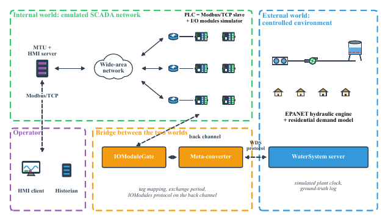

# SCADAVT 2.0 — a reproducible SCADA security testbed with a data-driven water plant

SCADAVT is a framework for building SCADA security testbeds from virtual parts.
The SCADA network (PLCs, routers, MTU, HMI server) is **emulated**: it runs real
Modbus/TCP traffic. The physical plant is **simulated**: a water distribution
network solved step by step by EPANET. A gateway (IOModuleGate) exchanges
measurement and control data between the two worlds.

This repository is the open rebuild of the plant layer of SCADAVT
(Almalawi et al., IEEE LCN 2013), described in the paper
*SCADAVT: a reproducible SCADA security testbed with a data-driven water
distribution plant* (submitted to *Internet of Things*, Elsevier).



## What is in this release

| Part | Module | Status |
|---|---|---|
| Hydraulic engine (EPANET 2.3, fixed steps, pressure-driven analysis) | `scadavt/wds/engine.py` | ✅ |
| Demand model (weekly per-person use, diurnal profile, occupancy) | `scadavt/wds/demand.py` | ✅ |
| Small-town case study: EPANET model (6 tanks, 12 pumps, 20 sub-areas) | `scadavt/scenarios/town/town.inp` | ✅ |
| SCADA description: 33 PLCs, 14 field sites, 194 tags, register maps | `scadavt/scenarios/town/scada.yaml` | ✅ |
| Message codecs: IOModules, WaterSystem (WDS), Modbus/TCP | `scadavt/protocols/` | ✅ |
| Supervisory logic of the MTU (pump hysteresis, V1 flow balancing) | `scadavt/master/control.py` | ✅ |
| Process-level reference mode and fault windows | `scadavt/experiments/offline.py` | ✅ |
| Experiment suite (E1–E4, 160 runs) and every figure/table of the paper | `scadavt/experiments/suite.py`, `scadavt/analysis/` | ✅ |
| Interactive viewer of the results | `docs/viewer.html` | ✅ |
| Networked services (PLC Modbus server, MTU loop, HMI server, IOModuleGate on CORE/containers) | — | ⏳ not in this release |

All experiments in the paper use the **process-level mode**: the supervisory
logic reads the plant and applies its commands directly every control period.
Faults are modelled by their physical consequence (a valve that keeps its last
setting; pumps commanded off), not by packet-level attacks.

## Quick start

```bash
python -m venv .venv && . .venv/bin/activate
pip install -r requirements.lock && pip install --no-deps -e .
python tools/fetch_consumption.py          # Melbourne Water weekly use per person
pytest -q tests                            # 10 tests
python -m scadavt.experiments.suite --out results          # 160 runs, ~10 s on 12 cores
python -m scadavt.analysis.make_figures --results results --out paper
python -m scadavt.analysis.diagrams --out paper/figures
python -m scadavt.analysis.viewer --results results --out docs/viewer.html
```

One simulated week takes about 0.7 s on one core (≈870,000× real time).

### Docker (exact reproduction)

```bash
docker build -t scadavt:2.0 .
docker run --rm -v "$PWD/out:/out" scadavt:2.0          # tests + suite + figures
```

The image pins Python 3.12.11 and every package (`requirements.lock`). With this
image all 160 runs match the published numbers exactly. Runs in which a tank
empties are sensitive to the compiled solver, so do not change the versions if
you want identical numbers.

## Data

The demand model is driven by the weekly *water use per person* published by
Melbourne Water (weeks ending 6 Jan 2022 to 1 Oct 2026). Melbourne Water
reserves all rights in these data, so they are **not** redistributed here;
`tools/fetch_consumption.py` downloads them from the utility's public service.
The diurnal profile has four periods and a peak hour of 2.06× the mean hour
(Gurung et al., *Resources, Conservation and Recycling* 90, 2014).

## Using SCADAVT for your own plant

1. Draw your network in the EPANET editor and save the `.inp` file.
2. Write a scenario YAML: population per demand node, PLCs, field sites and a
   tag list per PLC (`[tag, element, node|link, quantity, i|o]`). Register
   types and addresses are assigned automatically (status → coils / discrete
   inputs; other quantities → float32 in holding / input registers).
3. Adapt `scadavt/master/control.py` to your supervisory logic.
4. Run `scadavt.experiments.offline.run(...)` with your fault windows.

See [`docs/GUIDE.md`](docs/GUIDE.md) for the guidelines G1–G5, the protocols and
the scenario format.

## Citation

```bibtex
@inproceedings{almalawi2013scadavt,
  author    = {Almalawi, Abdulmohsen and Tari, Zahir and Khalil, Ibrahim and Fahad, Adil},
  title     = {{SCADAVT}-A framework for {SCADA} security testbed based on virtualization technology},
  booktitle = {Proc. 38th Annual IEEE Conf. Local Computer Networks (LCN)},
  pages     = {639--646},
  year      = {2013},
  doi       = {10.1109/LCN.2013.6761301}
}
```

## Licence

MIT (code). The Melbourne Water data keep their own terms.
